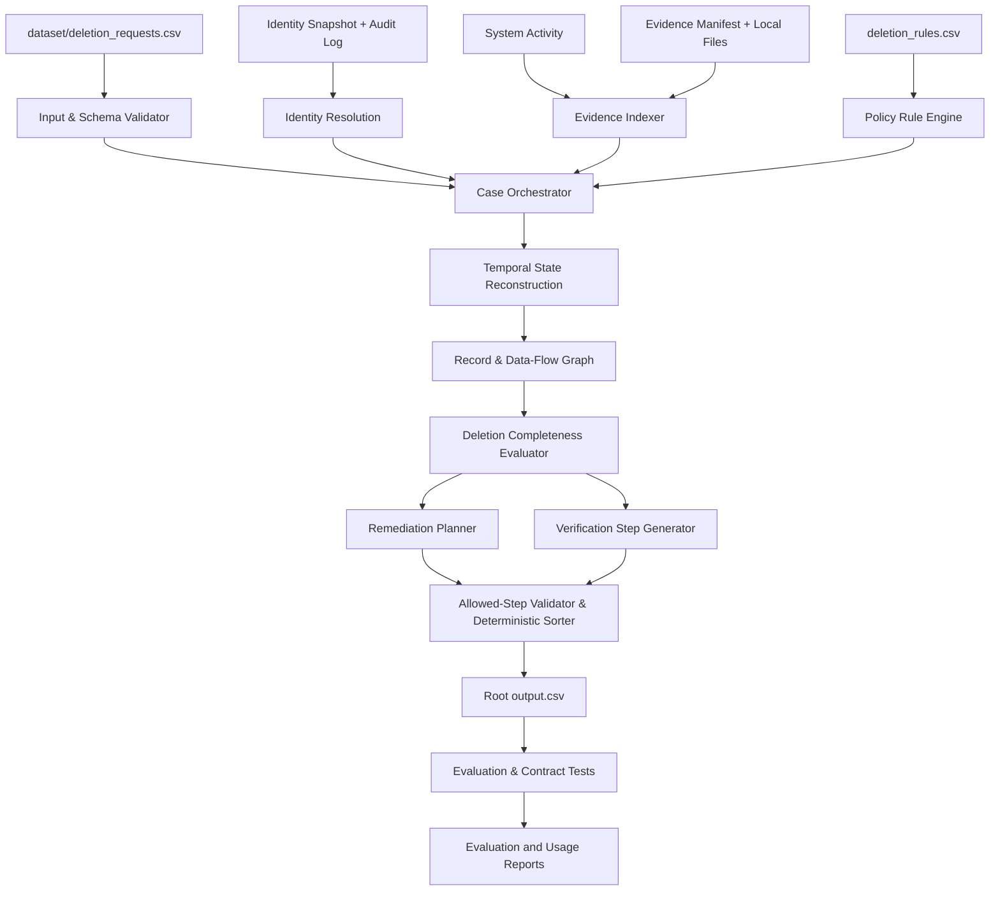

# System Architecture
## Ghost Data Still Exists

## 1. Architecture principles
1. Evidence first; model suggestions are not proof.
2. Deterministic policy enforcement.
3. Case-specific time cutoff at `audit_at`.
4. Full traceability from output steps to participant-visible evidence.
5. Separate fact extraction from decision-making and serialization.
6. Minimize model calls and avoid sending unnecessary personal data to external services.

## 2. Logical architecture



## 3. Recommended implementation stack
**Recommended default:** Python 3.11+ (confirm installed version), standard library plus focused parsing libraries as needed.

- `csv`, `json`, `datetime`, `pathlib`, `hashlib`, `sqlite3`, `re`: ingestion and deterministic logic.
- PDF parser such as `pypdf` if PDFs are present.
- Image OCR such as Tesseract/PaddleOCR or a VLM only if image content requires it and the environment permits.
- `pytest` for unit and regression tests.
- Optional LLM provider behind an adapter interface for multilingual intent classification or ambiguous document extraction.
- No database is necessary initially; in-memory indexes and a normalized evidence store are sufficient for 518 requests. SQLite can be useful for local indexing if performance or querying warrants it.

Avoid choosing libraries until the actual dataset formats and runtime constraints have been inspected.

## 4. Component responsibilities

### 4.1 Input & Schema Validator
- Resolve paths relative to repository root.
- Validate required files and columns.
- Parse timestamps with timezone awareness where present.
- Preserve original record IDs and source locations.
- Produce a clear ingestion report for missing/unreadable files.

### 4.2 Identity Resolver
- Seed with the request email and subject identity.
- Match current identity snapshot and historical audit events.
- Build a graph of identifier aliases and stable user references.
- Add only links supported by evidence.
- Store link provenance, source ID, timestamp, and confidence/reason.
- Avoid ambiguous cross-user joins.

### 4.3 Evidence Indexer
- Read the evidence manifest.
- Parse supported file types and extract searchable text/structured fields.
- Preserve `file_id`, path, origin, capture time, and extraction method.
- Build indexes for email, phone, email hash, stable user IDs, resource IDs, activity IDs, system IDs, and timestamps.
- Manifest membership alone never proves a file belongs to a user.

### 4.4 Temporal State Reconstructor
- For a given case, filter decision evidence to timestamps at or before `audit_at`.
- Reconstruct the latest supported state of each resource/process before the cutoff.
- Distinguish event claims (e.g. “delete succeeded”) from observed snapshots or corroborating evidence.
- Resolve conflicts using explicit source semantics and time ordering; if state cannot be proven, do not infer success.

### 4.5 Policy Engine
- Load `deletion_rules.csv` as data, not code constants tied to case IDs.
- Map each relevant resource/data category and condition to the required treatment.
- Produce an expected state per record: absent, redacted, anonymized, retained, or tombstone-compliant as defined by the rules.
- Enforce retention and permitted identifier constraints.

### 4.6 Data-Flow / Restore Graph
- Model systems/resources/processes as graph nodes and data movement or restore dependencies as directed edges.
- Mark edges/processes active or inactive based on evidence at the cutoff.
- Identify paths from data-bearing sources or backups to affected destinations.
- A relevant active path that can recreate prohibited data blocks COMPLETE.

### 4.7 Decision Engine
- Return NOT_APPLICABLE when the request does not authorize deletion.
- Return INCOMPLETE if any policy violation or unresolved recreation risk is established.
- Return COMPLETE only when all required treatments, retained-record conditions, and flow/restore conditions are evidenced as satisfied.
- Keep internal decision rationale structured and evidence-linked.

### 4.8 Remediation Planner
- Generate only allowed operations/states.
- Disable relevant flows and block unsafe restores before dependent record changes.
- Order downstream and upstream actions according to actual dependencies and the source contract.
- Avoid proposing deletion of records that policy requires to retain.
- Add verification for every remediation target/process.

### 4.9 Output Serializer and Validator
- Validate exact keys and enum values.
- Apply canonical phase/operation/system/resource ordering.
- Re-number steps after final sorting.
- Serialize JSON compactly and CSV-escape it using a proper CSV writer.
- Validate row count, uniqueness, sorting, and JSON parsing before success.

### 4.10 Evaluation Harness
- Compare the 32 public sample cases to `sample_output.csv` for contract/behavior feedback.
- Add unit tests for identity linking, temporal cutoff, rules, flows, tombstones, ordering, and serialization.
- Use at least three participant-created synthetic cases that do not depend on hidden truth.
- Report metrics accurately. Do not use organizer-only files or hidden labels.

## 5. Core internal interfaces
Suggested interfaces (names may vary):

```python
load_inputs(repo_root) -> Inputs
resolve_identity(request, identities, audit_log) -> IdentityGraph
index_evidence(manifest, evidence_root) -> EvidenceIndex
reconstruct_state(request, identity_graph, evidence_index, activity, cutoff) -> CaseState
evaluate_policy(case_state, rules) -> PolicyFindings
plan_remediation(findings, dataflow_graph, rules) -> list[Step]
build_verification(case_state, findings, rules) -> list[Step]
decide_case(request, case_state, findings) -> CaseResult
validate_and_serialize(results, output_path) -> None
```

## 6. Data flow and trust boundaries
- Participant-facing dataset files are the only source for predictions.
- `sample_output.csv` may be used as a public format/behavior reference, not as a hardcoded case-label mapping.
- External LLMs, if used, receive only the minimum evidence needed; redact unnecessary identifiers.
- Model output is untrusted input: validate against schema and allowed enums.
- Organizer-only files, generator internals, hidden labels, and secrets must never enter the prediction path or prompt examples.

## 7. Failure handling
- Missing evidence file: mark extraction as incomplete internally; do not silently claim that system is clear.
- OCR/parser failure: preserve failure metadata and use alternate extraction or explicit uncertainty.
- Conflicting evidence: retain both sources, apply documented precedence and cutoff, and avoid unsupported COMPLETE.
- Malformed model response: retry once if useful, then fall back to deterministic behavior or a controlled error.
- Invalid output: fail the run before packaging and display exact row/field/contract errors.
